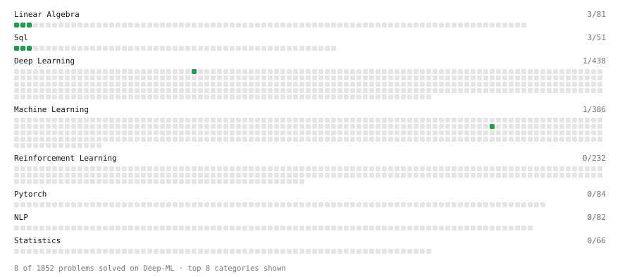

# Deep-ML

My machine learning practice from [Deep-ML](https://www.deep-ml.com). Every solution here was written by hand.

**13** solved · 13 problems · 0 labs · 0 math

[**Browse the interactive portfolio**](https://sachin2967.github.io/deep-ml/) to replay this filling in over time.

## Problems

| | Difficulty | Solved | |
| --- | --- | --- | --- |
| [Calculate Mean by Row or Column](https://www.deep-ml.com/problems/4) | easy | 2026-10-30 | [solution](problems/0004-calculate-mean-by-row-or-column) |
| [Filter rows with WHERE](https://www.deep-ml.com/problems/1103) | easy | 2026-09-19 | [solution](problems/1103-filter-rows-with-where) |
| [Implement a Simple Residual Block with Shortcut Connection](https://www.deep-ml.com/problems/113) | easy | 2026-10-30 | [solution](problems/0113-implement-a-simple-residual-block-with-shortcut-connection) |
| [Matrix-Vector Dot Product](https://www.deep-ml.com/problems/1) | easy | 2026-10-30 | [solution](problems/0001-matrix-vector-dot-product) |
| [Rejection Sampling Best-of-K Selection](https://www.deep-ml.com/problems/768) | easy | 2026-10-30 | [solution](problems/0768-rejection-sampling-best-of-k-selection) |
| [Reshape Matrix](https://www.deep-ml.com/problems/3) | easy | 2026-10-30 | [solution](problems/0003-reshape-matrix) |
| [Scalar Multiplication of a Matrix](https://www.deep-ml.com/problems/5) | easy | 2026-10-30 | [solution](problems/0005-scalar-multiplication-of-a-matrix) |
| [SELECT all rows](https://www.deep-ml.com/problems/1101) | easy | 2026-09-19 | [solution](problems/1101-select-all-rows) |
| [Select specific columns](https://www.deep-ml.com/problems/1102) | easy | 2026-09-19 | [solution](problems/1102-select-specific-columns) |
| [Tensor Puzzle: Reverse a Vector](https://www.deep-ml.com/problems/1278) | easy | 2026-11-01 | [solution](problems/1278-tensor-puzzle-reverse-a-vector) |
| [Transpose of a Matrix](https://www.deep-ml.com/problems/2) | easy | 2026-10-30 | [solution](problems/0002-transpose-of-a-matrix) |
| [Calculate Eigenvalues of a Matrix](https://www.deep-ml.com/problems/6) | medium | 2026-10-30 | [solution](problems/0006-calculate-eigenvalues-of-a-matrix) |
| [Matrix Transformation ](https://www.deep-ml.com/problems/7) | medium | 2026-10-30 | [solution](problems/0007-matrix-transformation) |

---

_This file is regenerated by Deep-ML on every push._
